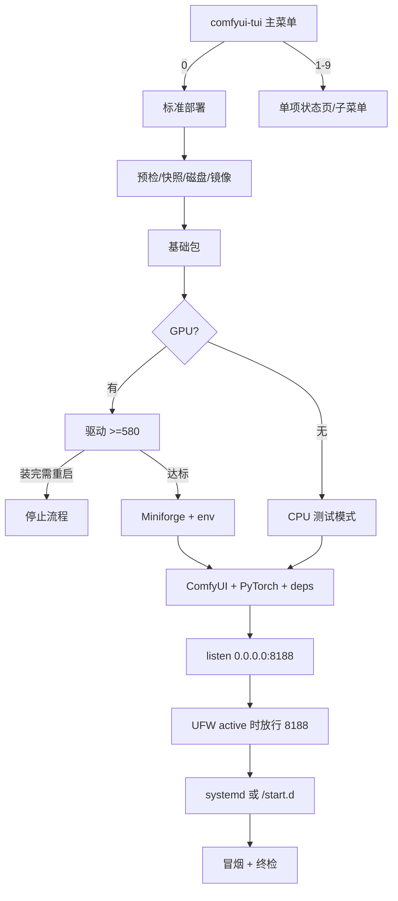

# 架构

## 单文件入口

`comfyui-tui.sh` 是**第二个用户入口**，与 `00-tui.sh` 并列，不 `source` 仓库内任何文件。UI 原语、备份、探测函数全部内联；与基础脚本约 200 行重复是 raw 单文件形态的代价，不做共享库。

启动只做环境前置检查（root / TTY / x86_64 / Debian 系）、状态探测和主菜单绘制；**不装软件、不写文件**。所有写操作必须由用户在子菜单显式选择，或走菜单 `0` 标准部署。

## 状态来源：原生系统，不落盘

| 关心的东西 | 权威来源 |
|---|---|
| GPU / 驱动 / CUDA | `lspci`、`/dev/nvidia*`、`nvidia-smi`、`dpkg -S nvidia-smi`、`dpkg-query`、`apt-cache policy`、`ubuntu-drivers devices` |
| 磁盘 | `df -Pk` 优先检测 `COMFY_DIR` 所在挂载点，目录未创建时回退 `/root` |
| Miniforge / Conda | `~/miniforge3`、`~/miniconda3`、`~/anaconda3`、`/opt/conda` 或 `PATH` 中的 `conda --version` |
| Python 环境 | 已存在有效 unit/`start.d` 的启动命令（容器优先 `/start.d`）、conda `comfyui`/`comfy` 环境、`COMFY_DIR/venv`、或本次进程手动切换的 `ENV_PY` |
| ComfyUI | 已存在有效 unit/`start.d` 的工作目录、`~/ComfyUI`、常见数据盘目录（含 `main.py` 或 `.git`），或本次进程手动切换的 `COMFY_DIR` |
| PyTorch | 当前 `ENV_PY` 内 `importlib.metadata` 读取版本；`torch_install` 与终检均执行 `import torch`（带超时保护）校验 CUDA 版本与 `cuda.is_available()` |
| 服务 | `/etc/systemd/system/comfyui.service` + `systemctl is-active/is-enabled`（先判 `/run/systemd/system` 再回退 `ps -p 1`）；或可执行 `/start.d/comfyui.sh` + `/proc` Python 进程精确匹配 |
| 访问方式与端口 | 有效启动命令分词解析 `--listen`（无参数或非回环地址为 `listen`；未带 `--listen` 或 `127.0.0.1`/`::1`/`localhost` 为 `tunnel`）及 `--port`（兼容算力平台自定义端口） |
| 端口与 HTTP | `ss -tln` 优先，回退 `/proc/net/tcp`、`/proc/net/tcp6`；HTTP 校验 `127.0.0.1:${PORT}/system_stats` 区分 ComfyUI 与其他端口占用进程 |
| 防火墙 | `ufw status`（`active` 时精确匹配端口列与 `ALLOW`/`LIMIT` 动作）；`inactive` 时回退 `ufw show added` 识别预写规则 |
| 公网 IP | 终检 `curl` 依次请求 `api.ipify.org` / `ifconfig.me` / `ipinfo.io/ip`；失败打印占位 |

**没有项目私有状态文件**：不写 `comfyui.conf`、不写进度标记。用户输入（CPU/GPU、访问方式、本次会话切换的 `COMFY_DIR` / `ENV_PY`）只存在于本次进程；服务、路径与访问方式一旦写入 unit/start.d，下次直接从原生系统文件探测读回。

## 运行时写入落点

| 路径 | 写入者 | 删除后 |
|---|---|---|
| `/etc/systemd/system/comfyui.service` | 菜单 8 / 标准部署 | systemd 不再管理服务（内容未变时幂等跳过重写与重启） |
| `/start.d/comfyui.sh`、`/start.d/log/comfyui.log` | 菜单 8 / 标准部署（容器平台） | 平台不再自启 / 无后台日志（内容未变时幂等跳过重写） |
| `/root/miniforge3/` | 菜单 4 / 标准部署 | Python 环境丢失 |
| `/root/ComfyUI/` | 菜单 5 / 标准部署 | 代码与 `models/` 丢失 |
| `/root/.condarc`、`/root/.config/pip/pip.conf` | 菜单 2/4/5 | 回退默认源 |
| `/root/.bashrc` | Miniforge `conda init`、cuda-toolkit PATH | shell 找不到 conda/nvcc |
| `/etc/apt/sources.list.d/cuda-*.list`、`/usr/share/keyrings/cuda-archive-keyring.gpg` | 菜单 3 / 标准部署（接入 NVIDIA 官方源时） | 回退系统默认 apt 源 |
| `/etc/apt/sources.list*` | 菜单 2 / 标准部署（用户确认执行 LinuxMirrors 换源时） | 影响系统 apt 软件源 |
| `/root/vps-init-backups/<时间戳>/` | 所有写配置前 | 失去人工回滚副本 |
| `/tmp/comfyui-tui.XXXXXX/` | 驱动 keyring、Miniforge 安装包、unit/start.d 候选文件 | 无影响（EXIT 清理） |

## 访问方式

- **listen（默认）**：unit/start.d 写 `--listen 0.0.0.0 --port 8188`。UFW active 时默认流程问一次并 `ufw allow 8188/tcp`；UFW inactive 时不启用，只提示云安全组。
- **tunnel（后备）**：菜单 7 移除 `--listen` 并重启，只监听回环；本地 `ssh -N -L 8188:127.0.0.1:8188 root@<IP>`。适合恢复 Manager 界面装插件。
- 两种方式都不改变 ComfyUI 的鉴权能力；公网暴露风险由用户承担。

## 自动检查的边界

`tools/sync_check.sh` 检查：两个入口存在、旧步骤脚本不复活、两个脚本都有 `shopt -s inherit_errexit`、不得引用私有状态文件、`COMFY_BASE` 与根 `README.md` 及 `comfyui-docs/README.md` 的 ComfyUI 包清单一致。它检查不到语法、ShellCheck、行为正确性与锁死链路；这些靠人工和真机验收。