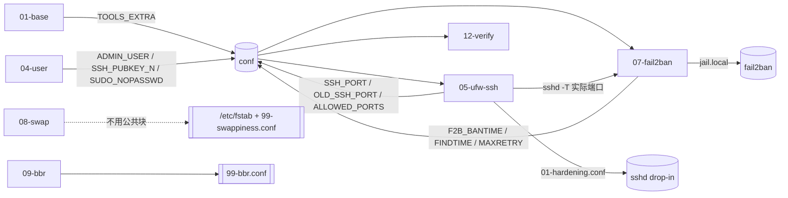

# 架构

## 仓库布局

```
/                     7 个步骤脚本 + 两个入口文档 + 仓库配置
docs/adr/             决策记录（0001 无编排器、0002 合并与步骤号）
docs/codewiki/        本目录：长期维护知识
docs/tutorial.md      手动等价教程（脚本改了它要跟）
tools/sync_check.sh   公共块一致性自检（唯一自动化检查）
```

根目录只允许放步骤脚本 `NN-xxx.sh`、`README.md` 和仓库配置；其余一律进 `docs/`、`tools/`、`.omp/`。

## 核心机制：自包含 + 内联公共块

每个脚本是**单文件可独立执行**的程序：不 `source` 仓库内任何文件，所需函数全部内联在脚本顶部。内联的是**公共函数的一个子集**——各脚本只带自己用到的那些，但同一函数在出现的每个脚本里必须逐字相同（`tools/sync_check.sh` 用 md5 比对 25 个函数）。

```
公共函数池（各脚本按需内联）
  ├─ 常量      SCRIPT_NAME / CONF / BK_ROOT
  ├─ 颜色与输出 log warn die err_trap
  ├─ 环境前置   require_root require_tty require_distro
  ├─ 交互       ask_yesno ask_input ask_input_def
  ├─ 备份       backup_file
  ├─ conf 读写  conf_has conf_read conf_write conf_get conf_update
  └─ 校验器     v_any v_yesno v_user v_pubkey v_ssh_port v_ports_list
                conf_val sshd_port rand_port
```

典型子集差异：`12-verify.sh` 只读，只有 `log/warn/die/err_trap/require_root/require_distro/conf_read`；`09-bbr.sh` 不含交互与 conf 函数；`07-fail2ban.sh` 额外带 `v_posint` / `v_ip` / `jail_val`（仅本脚本使用，不参与跨脚本比对）。

推导链（来自 ADR-0001）：raw 单文件交付 → 脚本必须自包含 → 公共逻辑只能内联 → 复制多份 → 必须用工具保证一致。**不要提议改回 `common.sh` + `source`**，那会让 raw 单文件执行直接失效。

`08-swap.sh` 是唯一例外：自带 helper（`ask_option` / `ask_value` / `confirm`，结果写入 `ANSWER`）、`set -uo pipefail`（不开 `-e`）、自有 `cleanup` trap。它不参与函数比对，但用了 `CONF` / `BK_ROOT` 就必须自己定义。

## 跨脚本契约

脚本之间**没有调用关系**，靠三样东西对齐：

1. **共享 conf**（`/root/.vps-init.conf`，600，root 属主）
2. **共享备份目录**（`/root/vps-init-backups/<时间戳>/`）——只保留最近 `BK_KEEP`=20 份，超出由 `bk_prune` 删最旧；内容与最新一份相同则复用该目录并刷新时间戳。裁剪只匹配 `YYYYmmdd-HHMMSS` 目录名，不触碰其他内容。
3. **一致的内联函数**（同名函数必须到处一样）



conf 键的权威表格在 `README.md`「参数只输一次」一节，这里不复制（复制必漂移）。

## 运行时数据落点

| 路径 | 写入者 | 删除后 |
|---|---|---|
| `/root/.vps-init.conf` | 01/04/05/07 | 重新询问，不影响系统配置 |
| `/root/vps-init-backups/<时间戳>/` | 01/04/05/07/08/09（`08` 写 `fstab[.N]`，其余写各自被改文件） | 失去人工回滚副本 |
| `/root/vps-init-report.md` | 12 | 重跑生成 |
| `/etc/ssh/sshd_config.d/01-hardening.conf` | 05 | sshd 回到未加固状态 |
| `/etc/fail2ban/jail.local` | 07 | 回到 fail2ban 默认（盯 22，等于失效） |
| `/etc/apt/apt.conf.d/20auto-upgrades` | 01 | 自动安全更新关闭，12 判红 |
| `/etc/sysctl.d/99-bbr.conf` | 09 | BBR 配置丢失（内核默认值） |
| `/etc/sysctl.d/99-swappiness.conf` | 08 | swappiness 回默认 |

## 执行顺序与前置自检

顺序由人保证（无编排器），脚本只拦住"已知会出事"的顺序错误：

| 脚本 | 前置断言 | 违反时 |
|---|---|---|
| 01 | root + TTY + Debian/Ubuntu | 直接退出 |
| 04 | root + TTY + 发行版 | 直接退出 |
| 05 | ufw 已安装、sshd 存在；`Include` drop-in 已启用 | 退出 |
| 05 `do_apply` | `ADMIN_USER` 真实存在（先于一切系统检查） | 退出，不写 AllowUsers |
| 05 `do_apply` | ufw 已启用 + 新端口已放行 + 迁移期旧端口仍放行 | 退出，不动 sshd |
| 05 `do_init` | `ufw show added` 里能看到新端口才 `ufw --force enable` | 退出，不启用 |
| 07 | `sshd -T` 可读且端口与 conf 一致 | **拒绝写 jail.local**（fail closed） |
| 07 | 退出前 jail 就绪 + 端口一致 | 退出码 1 |
| 12 | 无（只读）；conf 缺失则降级为纯系统检查 | 黄灯提示 |

## 失败与恢复语义

- **公共脚本**：`set -euo pipefail` + `shopt -s inherit_errexit` + `ERR` trap → `die "行 N: 命令"`，退出码 1。
- **`08-swap.sh`**：`set -uo pipefail`（不开 `-e`），段落内自行判错；`trap cleanup EXIT` 清理半成品 swap 文件与 fstab 备份提示。
- **默认不自动回滚**。唯一的两处刻意例外：
  1. `05-ufw-ssh.sh` 菜单 10：从备份恢复前先 `sshd -t`，失败则退回恢复前版本。
  2. `08-swap.sh`：fstab 修改后 `findmnt --verify` 失败且修改前基线正常时，从备份自动恢复。
- **备份时机**：写任何系统配置文件之前 `backup_file`，路径打印给用户。
- **锁死预案**：云控制台/VNC → 还原备份 → `systemctl reload ssh`；最终防线是步骤 0 的 Snapshot。

## 交互形态：菜单式脚本

`04` / `05` / `07` 采用同一形态：首次运行自动完成本步骤初始化 → 进入常驻菜单 → 重跑即维护。

- 菜单顶部是实时状态行，从系统读取而非读缓存。
- 一次只做一件事，`0` 退出。
- **菜单只呈现动作，不放宽闸门与前置自检**：走菜单重应用 SSH 加固，同样要过双闸门。

`08-swap.sh` 形态相同但实现独立（`ask_option` + 常量式选项文案）。

## 自动化检查的边界

`tools/sync_check.sh` 检查五类，且**只检查这五类**：

1. 公共函数跨脚本 md5 一致（比对 `01/04/05/07/09/12`）
2. `CONF` / `BK_ROOT` 定义一致，且用到就必须定义
3. 包清单：`01-base.sh` 的 `BASE` / `TOOLS_EXTRA` 与 README、`docs/tutorial.md` 逐项相同
4. 预期脚本文件存在（防误删/改名）
5. 关键行存在性：`shopt -s inherit_errexit`

检查不到的：语法、ShellCheck、行为正确性、文档与脚本语义是否一致、锁死链路是否被破坏。这些靠人工（见 [development.md](development.md)）。
