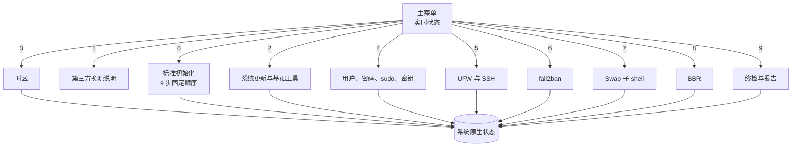

# 架构

## 仓库布局

```
/                     唯一入口脚本 00-tui.sh + README.md + 仓库配置
docs/adr/             决策记录（0001/0002 已被 0003 取代，0003 为现行决策）
docs/codewiki/        本目录：长期维护知识
docs/tutorial.md      手动等价教程（脚本改了它要跟）
tools/sync_check.sh   单入口一致性自检（唯一自动化检查）
```

根目录只允许放入口脚本 `00-tui.sh`、`README.md` 和仓库配置；其余一律进 `docs/`、`tools/`、`.omp/`。

## 核心机制：单文件 + 原生状态

`00-tui.sh` 是**唯一的可执行脚本**，单文件 raw 拉取即可运行：不 `source` 仓库内任何文件，所需函数全部内联。启动只做三件事——环境前置检查（root / TTY / Debian 系）、状态探测、绘制主菜单；**不装软件、不初始化系统、不写文件**。



## 状态来源：原生系统，不落盘

**本项目没有自己的状态文件。** 旧版用来保存参数的 `/root/.vps-init.conf` 已从代码中彻底移除；新入口不读、不写、不迁移、也不自动删除旧 VPS 上可能残留的那份文件。

| 关心的东西 | 权威来源 |
|---|---|
| SSH 有效配置 | `sshd -T`（端口、认证策略、AllowUsers、MaxAuthTries） |
| SSH 实际监听 | `ss -tln`（`sshd -T` 只读配置，不保证端口已绑定） |
| ufw 状态与规则 | `ufw status numbered` / `ufw status verbose`；未启用时 `ufw show added` |
| 管理员用户 | sshd 有效 `AllowUsers` 中唯一且存在的用户；否则 `getent passwd` 列候选 |
| 公钥 | `~/.ssh/authorized_keys`（逐行读取与改写） |
| 密码状态 | `passwd -S <用户>` |
| sudo 免密 | `LC_ALL=C sudo -l -U <用户>` 的有效权限，不靠文件存在性推断 |
| fail2ban | `systemctl is-active fail2ban` + `fail2ban-client status sshd` + `/etc/fail2ban/jail.local` |
| Swap | `/proc/swaps`、`/etc/fstab`、`sysctl vm.swappiness` |
| BBR | `sysctl net.ipv4.tcp_congestion_control`、`net.core.default_qdisc` |
| 时区 | `timedatectl show -p Timezone --value`；有效值来自 `timedatectl list-timezones` |
| 自动更新 | `/etc/apt/apt.conf.d/20auto-upgrades` + `apt-daily*.timer` |
| 已装包 | `dpkg-query -W -f='${Status}'` |
| 待升级事务 | `apt-get -s full-upgrade` 的 `Inst`/`Remv` 行 |

用户输入的偏好（可选工具清单、jail 参数、目标端口）**只存在于本次 Bash 进程**，不跨进程保存。服务所需的原生配置文件仍照旧创建与修改——它们是服务的持久状态，不是本项目的缓存。

## 运行时数据落点

| 路径 | 写入者 | 删除后 |
|---|---|---|
| `/root/vps-init-backups/<时间戳>/` | 所有写配置的动作（`backup_file`） | 失去人工回滚副本 |
| `/root/vps-init-report.md` | 菜单 9（终检） | 重跑生成 |
| `/etc/ssh/sshd_config.d/01-hardening.conf` | 菜单 5 / 标准初始化第 5 步 | sshd 回到未加固状态 |
| `/etc/fail2ban/jail.local` | 菜单 6 / 标准初始化第 6 步 | 回到 fail2ban 默认（盯 22，等于失效） |
| `/etc/apt/apt.conf.d/20auto-upgrades` | 菜单 2 / 标准初始化第 2 步 | 自动安全更新关闭，终检判红 |
| `/etc/sysctl.d/99-bbr.conf` | 无（菜单 8 只读，文件由用户按外部说明自建） | 与 `sysctl` 当前值一起显示；缺失不影响终检，只按 `tcp_congestion_control` 判黄 |
| `/etc/sysctl.d/99-swappiness.conf`、`/etc/fstab` | 菜单 7（Swap） | swap 持久化丢失 |
| `/etc/sudoers.d/<用户>` | 菜单 4 | sudo 免密关闭 |
| `~/.ssh/authorized_keys` | 菜单 4 | 公钥丢失 |
| `/etc/localtime` | 菜单 3（先备份到 `/root/vps-init-backups/<时间戳>/`） | 可从备份人工恢复原时区 |

备份目录只保留最近 `BK_KEEP`=20 份，超出由 `bk_prune` 删最旧；内容与最新一份相同则复用该目录并刷新时间戳。裁剪只匹配 `YYYYmmdd-HHMMSS` 目录名。

## 执行顺序与前置自检

顺序由「标准初始化」固定，菜单里的单项动作只拦住"已知会出事"的状态：

| 位置 | 前置断言 | 违反时 |
|---|---|---|
| 进程启动 | root + TTY + Debian/Ubuntu | `die`，退出码 1 |
| 菜单 5 加固 | `sshd_config` 已启用 `Include` drop-in；`ADMIN_USER` 存在且 UID 非 0 | 拒绝写 `AllowUsers` |
| 菜单 5 加固 | ufw active + 目标端口已放行 + 迁移期旧端口仍放行 | 拒绝改 sshd |
| 菜单 5 / 标准初始化第 5 步 | 启用 ufw 前必须能在规则里看到目标端口 | 拒绝 enable |
| 菜单 6 应用 | `sshd -T` 可读且 jail 端口与之一致 | **拒绝写 jail.local**（fail closed） |
| 菜单 3 设置时区 | 输入值必须在 `timedatectl list-timezones` 中；`/etc/localtime` 备份可确认 | 拒绝修改 |
| 标准初始化第 3 步 | 当前时区是系统列出的有效值且 NTP active | 中止剩余步骤 |
| 标准初始化第 4 步 | 管理员 UID 非 0；`authorized_keys` 非空且用户确认公钥登录与 `sudo -v` 可用 | 中止剩余步骤；有效 `AllowUsers` 仅允许 root 时不改 SSH |
| 标准初始化第 5 步 | 两道闸门 | 中止，不继续 fail2ban |
| 标准初始化第 6 步 | jail 就绪且端口一致 | 中止剩余步骤 |

## 失败与恢复语义

- **动作级**：菜单动作统一经 `act` 调用（临时关掉 `-e` 与 ERR trap），动作内每个危险步骤显式 `|| die_action` / `if !` 判错，失败只中止该动作并打印原因，TUI 继续可用。
- **进程级**：启动前置检查与输入中断（EOF/Ctrl-D）用 `die`，退出码 1。`set -euo pipefail` + `shopt -s inherit_errexit` + ERR trap 在动作之外保持生效。
- **`08` 的交互风格**：Swap 段保留 `set -uo pipefail`（不开 `-e`）、自有 helper、`trap cleanup EXIT`，由 `run_swap_menu()` 在子 shell 中运行，选项与 trap 不外泄。
- **默认不自动回滚**。两处刻意例外：
  1. 菜单 5 → 从备份恢复 `01-hardening.conf`：先 `sshd -t`，失败则退回恢复前版本。
  2. 菜单 7：fstab 修改后 `findmnt --verify` 失败且修改前基线正常时，从备份自动恢复。
- **锁死预案**：云控制台/VNC → 还原备份 → `systemctl reload ssh`；最终防线是上机前的 Snapshot。

## 交互形态：单入口 TUI

- 主菜单顶部是实时状态，每次绘制前重新读取。
- 主菜单：`0`–`9` 选功能、`q` 退出；空输入原地重问（**不会**映射成 `0`）；非法输入原地重问。
- 子菜单：`0` 或空回车返回主菜单。
- **进入任何编号都只是打开状态页/子菜单，不自动执行写操作**，必须再显式选动作。
- 清屏只在 stdout 是 TTY 且 `TERM` 可用、非 `dumb` 时发生；动作输出、错误诊断、闸门提示在用户确认前不清屏。

## 自动化检查的边界

`tools/sync_check.sh` 检查四类，且**只检查这四类**：

1. 入口脚本 `00-tui.sh` 存在，且已退役的步骤脚本没有复活
2. 关键行存在性：`shopt -s inherit_errexit`
3. 包清单：`00-tui.sh` 的 `BASE` / `TOOLS_EXTRA_DEFAULT` 与 README、`docs/tutorial.md` 逐项相同
4. 脚本里不得引用 `/root/.vps-init.conf`（防止私有状态被重新引入）

检查不到的：语法、ShellCheck、行为正确性、文档与脚本语义是否一致、锁死链路是否被破坏。这些靠人工（见 [development.md](development.md)）。
